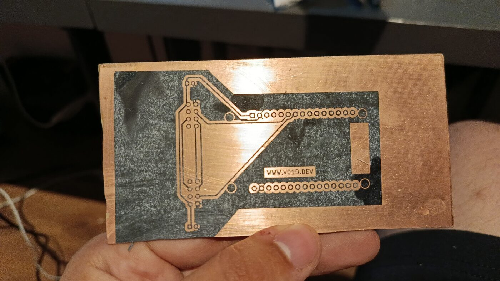
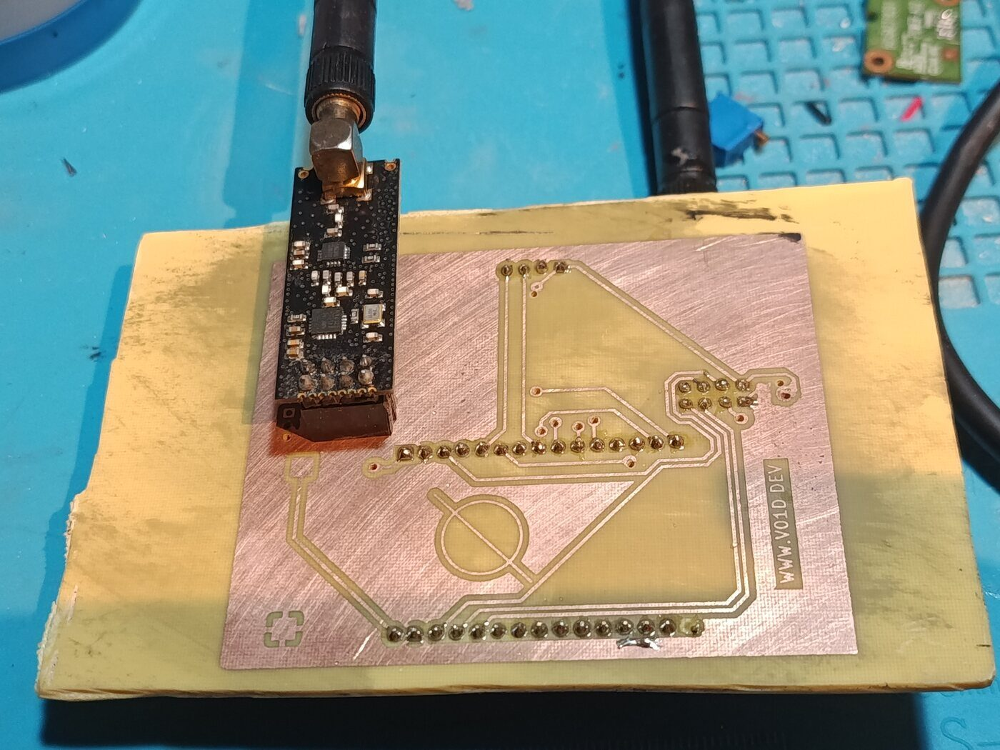

+++
date = '2026-10-13T22:05:37+03:00'
lastmod = '2026-11-26'
draft = false
title = 'How I Made an ESP32 Jamming PCB'
+++

## Introduction

I love soldering wires onto perfboard, and for a quick prototype it's fine. But try soldering three SPI components to an ESP32 and there's no way to avoid a rat's nest.

So, like our forefathers in electronics, I made a PCB. Most people just order them from JLCPCB or PCBWay these days, but shipping to Turkey plus the cost of a local fab made no sense for a board this size.

So I made it at home: toner transfer, etch, drill, solder. The fabrication turned out to *be* the project, and the board was just what it happened to produce.



## The Goal

I wanted to recreate the ESP32 + nRF24 jamming board from [EmenstaNougat](https://github.com/EmenstaNougat/ESP32-BlueJammer) at home: two nRF24L01+PA+LNA modules on their own SPI buses so both radios run independently, an SSD1306 OLED for status, and an ESP32 DevKit V1 driving it all.

The hardware is fully compatible with the upstream firmware, so the software was already solved. My work was the schematic, the layout, and the fabrication.

> **A note on legality:** deliberately disrupting radio communications is illegal in most jurisdictions. This is a bench project for learning how 2.4 GHz protocols behave, and it should only ever be powered up in an environment you own or have written permission to test in.

## Part 1: CAD Design

### KiCad Set Up

The schematic is the easy part, and making the board at home doesn't change it. Two nRF24L01+PA+LNA modules on separate SPI buses:

| Bus | SCK | MISO | MOSI | CSN | CE |
|-----|-----|------|------|-----|-----|
| HSPI | 14 | 12 | 13 | 15 | 16 |
| VSPI | 18 | 19 | 23 | 21 | 22 |

An SSD1306 OLED on I2C (GPIO 4 and 5), and a 100 µF electrolytic capacitor across the supply of each radio. Those capacitors are not optional. The nRF24 draws current in sharp bursts when it transmits, and without bulk capacitance right at the module it browns out and drops off the bus.

The real work was the **footprints**. None of these parts exist in the stock KiCad libraries:

- The ESP32 DevKit V1 module.
- The nRF24L01+PA+LNA breakout, which is a module with an 8-pin header, not a chip.
- The SSD1306 OLED. I couldn't find one that worked in a current KiCad, so I made one and [published it as a library](https://github.com/V01Ddev/kicad-ssd1306-oled-library).

Drawing footprints is tedious, but you only do it once.

### Designing For Your Kitchen, Not A Fab House

This is the part no KiCad tutorial covers, because every tutorial assumes you're sending the files to a fab house. A fab house does three things for you that you can't do at home:

- **Plated through-holes.** On a professional board, copper is plated through every hole, so the top and bottom of a pad are the same piece of metal. At home, a hole is just a hole.
- **Vias.** A plated hole that connects one layer to another. Same problem.
- **Solder mask.** The green stuff. It covers everything except the pads, so solder can't end up on your traces.

Designing for home fabrication is mostly designing around not having those three things.

#### Vias become wires

I didn't understand this until I'd finished the first layout: plating is what joins the top copper to the bottom copper. At home, nothing joins them. So a via isn't a routing convenience, it's an instruction to yourself: *solder a wire here.* My commit says exactly that:

> added VIAs to schmatics to connect front layer and back layer when making it at home

Fourteen of them, at KiCad's default of **0.6 mm with a 0.3 mm hole**. There is no version of me drilling a 0.3 mm hole by hand, let alone threading wire through it. So they grew:

| Revision | Via pad | Hole | Count |
|----------|---------|------|-------|
| First pass | 0.6 mm | 0.3 mm | 14 |
| Enlarged | 1.2 mm | 0.8 mm | 14 |
| Working board | 1.8 mm | 1.0 mm | 16 |
| Final, compact | 1.8 mm | 0.5 mm | 10 |

These are the milestones, not every version. I went through a lot of versions of this board, and at one point it had 23 vias.

The 0.8 mm isn't a coincidence, it's the only drill bit I own. Enlarging the vias made each one survivable. Redesigning so there were fewer of them made the board buildable.

#### Two layers cost you twice

I wasn't happy about two layers from the start:

> had to be double sided... Not that happy with it but it should work

And once I'd finished routing:

> Finished PCB. Dumb move to make it two layer. Nearly impossible to make at home...

The etching itself takes the same time, both sides etch at once. The cost is everywhere else. Every crossing net costs you a via, and the front and back artwork have to line up hole for hole. Aligning them takes time, and you can't tell if they're aligned until you're soaking the paper off in water. During my R&D I usually had to clean the board and redo the transfer multiple times before I got something usable enough to etch.

This is V1 with the toner transferred, before etching. The toner is the artwork, and the shiny copper around it is about to be eaten away. That board was 58.5 × 107.5 mm.

#### Clearances and trace widths

Without a solder mask, the gap between traces is the only thing stopping a solder bridge. So I left more space than KiCad's defaults. Home etching also under-cuts: the etchant creeps sideways under the toner, so traces come out thinner and gaps wider than you drew them. Thin traces are the first to disappear if you leave the board in too long. Nothing here carries real current, so I kept everything chunky.

#### Alignment

To connect the layers you drill through both, and the front pad has to sit on top of the back pad. If the artworks are out of register, you drill between pads and the wire has nothing to solder to. I added centering lines, but the commit says what I thought of them:

> added centering lines, still need to find a better method

What works best for me: poke holes through the printed paper at two pad locations, the same two on both the front and back sheets. Drill those two holes in the PCB using one side as the reference. Then line the paper holes up with the drilled holes and tape everything down with Kapton tape. Clean the holes first so the paper sits flush.

### Exporting the Artwork

Once DRC is clean, plot the copper layers. Not gerbers, those are for a fab house. You want something a laser printer can print, so I exported front and back copper as SVGs at A4.



Two things to get right. **Mirror the front layer, not the back.** KiCad already flips the back layer when plotting, so the front is the one you reverse yourself. And print at exactly 100% scale, not "fit to page", or your 2.54 mm header pitch won't be 2.54 mm.

## Part 2: Creation

### Toner Transfer

Laser printer toner is plastic. Print your artwork, press it onto clean copper while hot, dissolve the paper away, and you're left with a plastic resist in the exact shape of your traces.

**Clean the copper properly.** 120 grit sandpaper until it's polished, then acetone or isopropyl. Don't touch it after that. Toner won't stick to a fingerprint.

**Print onto magazine paper.** Cheap magazine paper cut to A4 releases the toner cleanly and costs nothing. It has to be a laser printer. Inkjet won't work.

**Use a laminator, not an iron.** An iron gives you uneven pressure and heat. A laminator gives you the same heat and roller pressure across the whole board. I use the cheapest A3 laminator I could find on [Trendyol](https://www.trendyol.com/kraf/a3-laminasyon-makinesi-lm-1015-mavi-p-822959166?merchantId=856626), unmodified. It's hot enough after about 3 passes, then I do a lot more, feeding the board in from a different side each time so the pressure lands everywhere.

Let it cool completely, peel a corner to check, and if the toner is lifting, run it through again. Then soak it in water and rub the paper off with your thumb. Touch up any gaps with a permanent marker, which resists etchant well enough and is much faster than redoing the transfer.

### Etching

Wherever the toner sits, the copper stays. Everywhere else, it goes. I mixed my own etchant from local stuff:

- **Hydrochloric acid**, sold as *tuz ruhu* in hardware stores. 30% strength.
- **Hydrogen peroxide**, sold as *oksijenli su* in pharmacies. 50% strength, not the 3% for cuts.
- **Water.**

The mix is **4 parts water, 2 parts acid, 1 part peroxide**. It etches in a few minutes at room temperature, and since it's transparent you can watch the copper disappear, which helps a lot while you're learning.

**Mix it in this order: water first, then slowly add the acid, then the peroxide.** Mixing it in any other order can cause a violent reaction that splatters acid everywhere.

**The safety here is not optional.** This mixture fumes. Do it outdoors or with real ventilation, never in a closed room. I wear a [3M 6200 half mask](https://www.trendyol.com/3m/6200-gaz-maskesi-standart-beden-6059-abek1-filtre-dahil-set-p-65913687?merchantId=556149) with ABEK1 cartridges, gloves, and eye protection. Use glass or plastic, never metal. The spent solution has dissolved copper in it, so it's toxic waste. Bottle it and take it to a disposal point, don't pour it down the sink.

I've since switched to **ferric chloride**, bought as a powder from Trendyol. No acid fumes, and it keeps. But it stains everything permanently, it's opaque so you can't watch the board, and it works much better warm. Still not something for the drain.

Either way, warm it and agitate it. Faster etching means less sideways creep. Take the board out the moment the last bare copper is gone, because over-etching is how you lose thin traces. Then clean the toner off with acetone.

### Drilling

I cut the board to size with a Dremel and a cutting bit. FR4 is glass fibre, so I added a particle filter to the 3M mask, plus eye protection.

For holes I use a [mini drill](https://www.robotistan.com/mini-drill-6-18v-dc-pcb-matkabi-mini-el-matkabi-quantum) in a [drill stand](https://www.robotistan.com/mini-drill-standi-el-matkabi-sehpasi-343), powered by a 12 V adapter I had lying around.

The stand matters much more than the drill. A 0.8 mm bit freehand wanders, snaps, and won't go in straight. In a stand, it goes where you put it. A worse drill in a decent stand beats the other way around.

I use a single 0.8 mm bit from Bauhaus for everything, so I'm not swapping and breaking small bits. Afterwards, twist a slightly larger bit through each hole by hand to remove the burr, which can otherwise lift the pad.

### Vias

This is where V1 went. Not the etching, not the drilling, the vias.

Each via is a hole with a wire soldered on both sides. I use enamelled copper wire, the stuff in motor coils. It's thin enough for a 0.8 mm hole and insulated, so it can't short against anything nearby. The enamel burns off where the iron touches it, though some enamels need scraping.

1. Thread a short piece of wire through the hole.
2. Solder it on one side.
3. Flip the board.
4. Solder the other side.
5. Trim flush.

Step 1 is the hard one, because of alignment. The hole has to land inside the pad on *both* layers, and if the artwork was slightly out of register, it won't. That's where most of V1's time went. If I'd tell someone starting out one thing: design as few vias as possible, and make the ones you keep as big as you can.

### Soldering

Everything is through-hole, which is the forgiving end of soldering. But with no solder mask, solder is happy to flow onto any trace, and a bridge to the ground pour is the easiest to make and the hardest to see.

- **Flux does most of the work.** It makes the solder flow where you want and stay there.
- **Tack one pin first.** Check the module sits flat and square before doing the rest.
- **Use headers instead of soldering modules directly.** The nRF24 modules are the most likely to die, and swapping beats desoldering.
- **Check as you go.** Use a multimeter to check for continuity between adjacent pins before powering anything.

I dropped the status LED along the way. The OLED already shows the mode, and the LED was one more thing to get wrong.

### The Result

This is V2 after etching and soldering, before cutting it to size. It's 64.14 × 77.47 mm with 10 vias, down from 107.5 mm long in V1 and 23 vias at the worst point across all the versions. Not so much a smaller board as a board that knows how it's going to be made.

V1, on the right in the photos at the top, has everything mounted: the ESP32 on the back, both radios on top with their antennas, and the OLED showing the active mode. I also modelled and printed [stands](https://github.com/V01Ddev/ESP32-Jammer) in FreeCAD to hold the radios and screen in place.

### What I'd Do Differently

**Design for the process from the beginning.** My first revision was drawn like a board that was going to be manufactured, and it was nearly impossible to make. That whole first pass was a lesson in designing for the wrong factory.

**Fewer vias, bigger vias.** Every via is a hole, a wire, and two joints you have to get right. KiCad's 0.6 mm default looks innocent on screen and is invisible in real life.

**I still want a solder mask.** There's no practical way to do a proper one at home. I've been looking into conformal coating: it won't stop bridges while soldering, but it protects the finished board from oxidation and shorts.

### Conclusion

I wanted a board that wasn't a rat's nest, and it ended up being about the fabrication. Making PCBs at home is slower, messier, and far more failure-prone than uploading gerbers. But now I understand why boards are laid out the way they are, why vias go where they do, and how much a solder mask quietly does for you.

The schematic, PCB, firmware and 3D models are on [GitHub](https://github.com/V01Ddev/ESP32-Jammer), and the SSD1306 footprint library is [here](https://github.com/V01Ddev/kicad-ssd1306-oled-library). If you've done home fabrication and have a better answer for via alignment or solder masks, I'd genuinely like to hear it.

Feel free to check out my other [blog posts](https://v01d.dev/blog) or find the source code to my projects on my [GitHub](https://github.com/V01Ddev).
