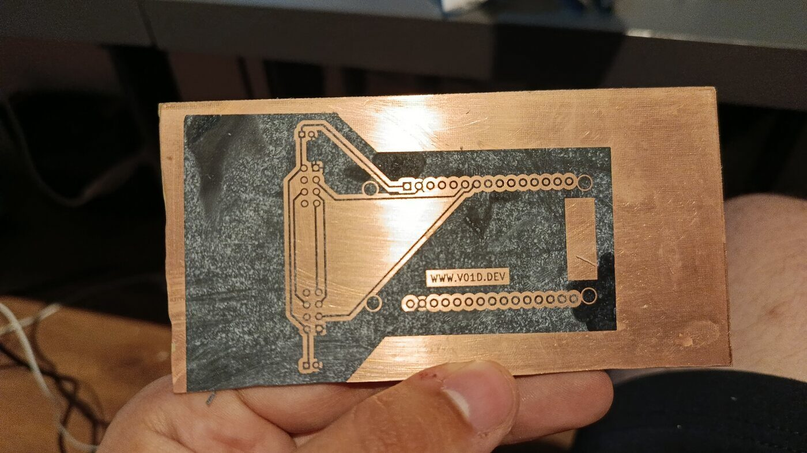
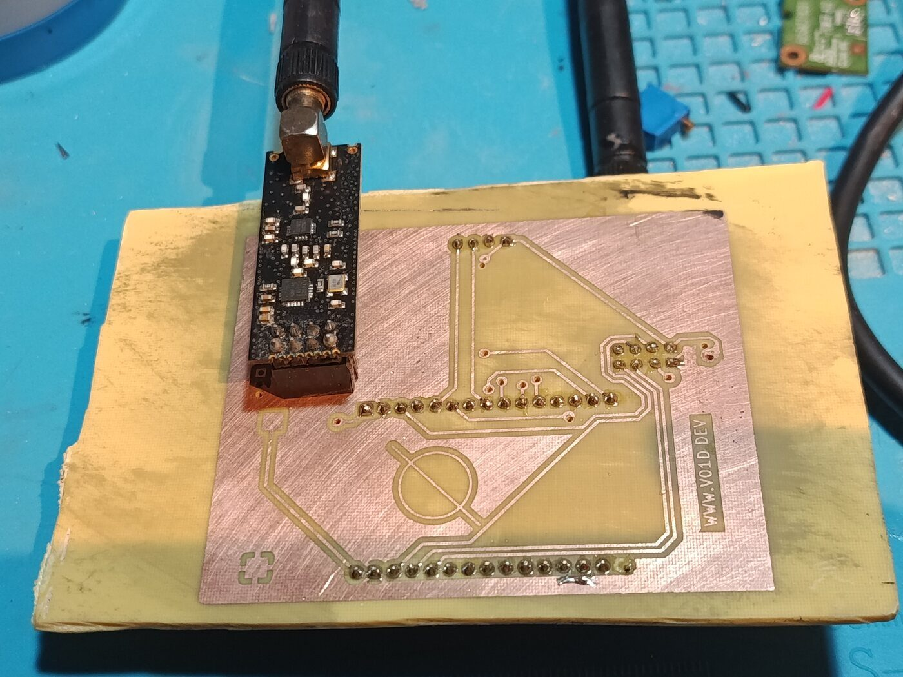

+++
date = '2026-10-13T22:05:37+03:00'
draft = false
title = 'How I Made an ESP32 Jamming PCB'
+++

## Introduction

As much as I love soldering wires onto perfboard, it quickly becomes unrealistic to maintain projects. Don't get me wrong, for a quick prototype it's fine. But try soldering three SPI components to an ESP32 and there is no way to avoid a rat's nest of a board.

As many of our forefathers in electronics have done, we should make PCBs. With the rise of services like JLCPCB and PCBWay, most people just order them. I didn't, because shipping to Turkey plus the cost of a local fabrication service made no sense for a board this size.

So I made it at home: toner transfer, etch, drill, solder. It turned out the fabrication *was* the project, and the board was just what it happened to produce.

## The Goal

My main objective was to recreate the ESP32 + nRF24 jamming board from [EmenstaNougat](https://github.com/EmenstaNougat/ESP32-BlueJammer) at home. Two nRF24L01+PA+LNA modules, each on its own SPI bus so both radios run independently, an SSD1306 OLED for status, and an ESP32 DevKit V1 driving all of it.

I wanted the hardware to be fully compatible with the upstream firmware, so the software side was already solved for me. My work was the schematic, the layout, and the fabrication. I went in wanting to learn how a board actually gets made, and I came out knowing a lot more about why boards are designed the way they are.

> **A note on legality:** deliberately disrupting radio communications is illegal in most jurisdictions. This is a bench project for learning how 2.4 GHz protocols behave, and it should only ever be powered up in an environment you own or have written permission to test in.

## Part 1: CAD Design

### KiCad Set Up

The schematic is the easy part, and it's no different from any other project. Nothing about making the board at home changes it.

You draw what you'd otherwise wire by hand. Two nRF24L01+PA+LNA modules on separate SPI buses, so they can sweep independently:

| Bus | SCK | MISO | MOSI | CSN | CE |
|-----|-----|------|------|-----|-----|
| HSPI | 14 | 12 | 13 | 15 | 16 |
| VSPI | 18 | 19 | 23 | 21 | 22 |  
  

An SSD1306 OLED on I2C (GPIO 4 and 5), and a 100 µF electrolytic capacitor across the supply of each radio. Those capacitors are not optional. The nRF24L01+PA+LNA draws current in sharp bursts when it transmits, and without bulk capacitance right at the module it browns out and drops off the bus mid-sweep.

The real work in the schematic was the **footprints**. None of the parts I was using exist in the stock KiCad libraries:

- The ESP32 DevKit V1 module, with its two rows of pins at the right spacing.
- The nRF24L01+PA+LNA breakout, which is a module with an 8-pin header, not a chip.
- The SSD1306 OLED. I couldn't find a version that worked in a current KiCad, so I made one, and [published it as a library](https://github.com/V01Ddev/kicad-ssd1306-oled-library) afterwards. It's the same footprint that ended up on this board.

Drawing footprints is tedious, but you only do it once and then you own it forever.

### Designing For Your Kitchen, Not A Fab House

This is the part that actually matters, and it's the part no KiCad tutorial covers, because every tutorial assumes you're going to email the files to a fabrication house.

A fab house does three things for you that you cannot do at home:

- **Plated through-holes.** On a professional board, every pad has copper plated through the barrel of the hole, so the top and bottom of a pad are the same piece of metal. At home there is no plating. A hole is just a hole, and the top and bottom copper are only connected if you connect them.
- **Vias.** A via is a plated hole that connects one layer to another. Same problem, and this board needs ten of them even after I reworked it to need as few as possible.
- **Solder mask.** The green stuff. It's a lacquer that covers everything except the pads you're meant to solder to. Without it, every trace on your board is a place solder can end up.

So designing for home fabrication is mostly about designing around not having those three things.

#### Vias become wires

Here's the thing I didn't understand until I'd already finished the first layout: **every through-hole pad on a professional board is plated**, and plating is what joins the top copper to the bottom copper. At home, nothing joins them. A pad with a hole in it is a hole in two separate sheets of copper that happen to be lined up.

So a via on a home-made board isn't a routing convenience, it's an instruction to yourself: *solder a wire here.* That's exactly what my commit says:

> added VIAs to schmatics to connect front layer and back layer when making it at home

Fourteen of them, in one go. Then the sizes, which is where the real lesson is. KiCad's default via came out at **0.6 mm with a 0.3 mm hole**, and I put fourteen of those into the layout because that's what the tool gave me. There is no version of me drilling a 0.3 mm hole by hand, let alone threading wire through it.

So they grew:

| Revision | Via pad | Hole | Count |
|----------|---------|------|-------|
| First pass | 0.6 mm | 0.3 mm | 14 |
| Enlarged | 1.2 mm | 0.8 mm | 14 |
| Working board | 1.8 mm | 1.0 mm | 16 |
| Final, compact | 1.8 mm | 0.5 mm | 10 |

The 1.2 mm revision is where the 0.8 mm shows up, and that's not a coincidence. That's the size of the only drill bit I own. A via you can actually see, drill, and get wire through is worth ten miniature ones you can't.

The final board is down to 10 vias, and that's the real win. Enlarging them made each one survivable; redesigning so there were fewer of them made the board buildable.

#### Two layers cost you twice

My first layout was two layers, and I was unhappy about it from the schematic onwards:

> had to be double sided... Not that happy with it but it should work

Then, once I'd finished routing it:

> Finished PCB. Dumb move to make it two layer. Nearly impossible to make at home...

Two layers doesn't just double the etching. It means every net that needs to cross another net costs you a via. It means the front artwork and the back artwork have to line up with each other, hole for hole, and at home you're aligning them by eye against a light source. And it means you have to keep the board in the etchant twice as long overall, so the risk of over-etching doubles with it.

This is what V1 looked like with the toner transferred and before anything was etched. The artwork is the toner; the shiny copper around it is what's about to be eaten away. That board was 58.5 × 107.5 mm.

#### Clearances and trace widths

Without a solder mask, the gap between two traces is the only thing stopping a solder bridge. So I left more space than KiCad's defaults, both for my own sake when soldering and because a home-etched board under-cuts slightly. The etchant doesn't just eat downwards, it creeps sideways under the edges of the toner, so every trace comes out a little thinner and every gap a little wider than you drew it.

That cuts both ways. Thin traces are the first thing to fail, because they're the first thing to disappear entirely if you leave the board in too long. Nothing on this board is carrying real current, so I could afford to keep everything chunky.

#### Alignment

To connect the two layers you have to drill through both, and the front pad has to be sitting on top of the back pad when you do it. If the two artworks are out of register, you're drilling through the gap between pads rather than through the pad, and the wire has nothing to solder to on one side.

I added centering lines to the artwork for this, which helped, but the commit says what I actually thought of it:

> added centering lines, still need to find a better method

What I found works best is this. Poke a hole through the printed paper where a hole should be made, at two different locations, on both the front and back sheets, making sure you're poking the same two holes in each. Then drill through the PCB using one side as a reference. Now align the holes in the paper with the holes in the PCB and hold everything down with Kapton tape. Make sure the drilled holes are clean so the paper sits flush.

### Exporting the Artwork

Once the board is done and DRC is clean, you plot the copper layers. Not gerbers, because gerbers are for a fab house. You want something you can put through a laser printer, so I exported the front and back copper as SVGs at A4.



Two things to get right here. **Mirror the front layer, not the back.** KiCad already flips the back layer when it plots it, so the B.Cu artwork comes out ready to press straight onto the copper. The front is the one you have to reverse yourself. And print at exactly 100% scale, not "fit to page", or your 2.54 mm header pitch won't be 2.54 mm and nothing will fit.

## Part 2: Creation

### Toner Transfer

Laser printer toner is plastic. It melts, and when it cools it sticks to whatever it cooled onto. So if you print your artwork in toner, press it onto clean copper while it's hot, and then dissolve the paper away, you're left with a plastic resist bonded to the copper in exactly the shape of your traces. That's the whole idea.

The details that matter:

**Clean the copper properly.** I go over the board with 120 grit sandpaper until the copper has a nice polish, then wipe it down with acetone or isopropyl. After that, don't touch the surface with your fingers. Skin oil is the enemy, and toner will not stick where you've left a fingerprint.

**Print onto magazine paper.** I use cheap magazine paper cut down to A4. It releases the toner cleanly and it costs nothing next to proper transfer paper. Whatever you use, it has to go through a laser printer. Inkjet will not work at all, this has to be toner.

**Use a laminator, not an iron.** An iron works, but it's a flat plate you're pressing by hand, so the pressure is uneven and one side of the board always gets more heat than the other. A laminator gives you consistent heat and consistent roller pressure across the whole board.

I use the cheapest A3 laminator I could find on [Trendyol](https://www.trendyol.com/kraf/a3-laminasyon-makinesi-lm-1015-mavi-p-822959166?merchantId=856626), and I didn't need to modify it at all. It gets more than hot enough in about 3 passes. After that I do a lot more passes, feeding the board in from a different point and a different direction each time, so the pressure lands everywhere rather than in the same two tracks.

Then let it cool completely before you touch it. Peel a corner to check, and if the toner is lifting anywhere, press it back down and run it through again.

Soak the board in water for a few minutes and rub the paper off with your thumb. What's left is your board in black plastic. Anywhere the toner didn't take, touch it up with a permanent marker. Marker ink resists etchant well enough, and it's much faster than redoing the transfer.

### Etching

The toner is the resist. Everywhere it sits, the copper stays. Everywhere it doesn't, the copper has to go.

I mixed my own etchant out of what I could buy locally:

- **Hydrochloric acid**, sold as *tuz ruhu* in any hardware store, for cleaning drains and grout. The 30% strength.
- **Hydrogen peroxide**, sold as *oksijenli su* in any pharmacy. The 50% strength, not the 3% you'd disinfect a cut with.
- **Water.**

The mix is **4 parts water, 2 parts acid, 1 part peroxide**. Together, that etches copper in a few minutes at room temperature. And because it's transparent, you can watch the copper disappear through the side of the container, which is genuinely useful when you're learning how long it takes.

**The safety here is not optional.** This mixture fumes, and the fumes are not something you want in a flat. Do it outdoors or somewhere with real ventilation, never in a closed room. I wear a [3M 6200 half mask](https://www.trendyol.com/3m/6200-gaz-maskesi-standart-beden-6059-abek1-filtre-dahil-set-p-65913687?merchantId=556149) with the ABEK1 cartridges it comes with, plus gloves and eye protection. Add the acid to the water and not the other way around. Use a glass or plastic container, never metal. And when you're done, the spent solution has dissolved copper in it, so it is toxic waste. Bottle it and take it to a disposal point. Do not pour it down the sink.

I've since switched to **ferric chloride**, which I buy as a powder from Trendyol and mix myself. It's less unpleasant to work with: no acid fumes, and it keeps. The trade-offs are that it stains anything it touches permanently, it's opaque so you can't watch the board, and it works much better warm. It's still not something you pour down a drain.

Whichever you use, warm it up and agitate the container. Both of those speed it up dramatically, and faster etching means less sideways creep under the toner. Take the board out the moment the last bit of bare copper is gone. Over-etching is how you lose thin traces and how your carefully-spaced gaps turn into canyons.

Then clean the toner off with acetone, and what's left is copper traces on FR4.

### Drilling

First I cut the board down to size with a Dremel and a cutting bit. FR4 is glass fibre, so the dust is not something you want to breathe. I added a particle filter to the same 3M mask for this, along with eye protection.

For the holes themselves, I use a small [mini drill](https://www.robotistan.com/mini-drill-6-18v-dc-pcb-matkabi-mini-el-matkabi-quantum) mounted in a [drill stand](https://www.robotistan.com/mini-drill-standi-el-matkabi-sehpasi-343). Mine didn't come with a power supply, so I wired it to a 12 V adapter I had lying around.

The stand matters much more than the drill. A 0.8 mm bit is thin enough to wander across the copper and snap before it bites, and doing it freehand means you'll be lucky to hit your pad, let alone keep the hole perpendicular so the wire goes through. In a stand, the bit goes where you put it and the hole goes straight down. You could put a much worse drill in a decent stand and get a better result than the other way around.

I use a single 0.8 mm bit from Bauhaus for everything. Keeping to one size means I'm not swapping bits and I'm not breaking the small ones by handling them. Worth doing afterwards: twist a slightly larger bit through each hole by hand to knock the burr off the back, because a burr can lift the copper pad it came through.

### Vias

This is where V1 went. Not the etching, not the drilling, the vias.

A via is a hole through both layers with a wire soldered on each side. The wire I use is enamelled copper wire, the thin stuff wound into motor and transformer coils. It's the right choice for two reasons: it's thin enough to pass through a 0.8 mm hole, and it's insulated, so it can't short against anything it passes near on the way through. The enamel burns back wherever the iron touches it, so you get a clean joint without stripping anything first, though how well that works depends on the wire. Some enamels need scraping.

The process is simple and the execution is not:

1. Thread a short piece of wire through the hole.
2. Solder it down on one side.
3. Flip the board over.
4. Solder it on the other side.
5. Trim the excess flush.

The gauge doesn't really matter. What matters is that it goes through the hole and stays stiff enough to push through without folding.

The hard part is step 1, and it's hard because of alignment. The hole you drilled has to land inside the pad on *both* layers, and if the front and back artwork were even slightly out of register when you transferred them, it won't. This is what the centering lines were for, and it's why V1 was mostly spent on this rather than on anything else. If there's one thing I'd tell someone starting out, it's to design as few vias as you possibly can and make the ones you keep as large as you can get away with.

### Soldering

Everything here is through-hole, which is the forgiving end of soldering. But there's no solder mask, so every trace on the board is a surface solder is happy to flow onto. Bridges are the failure mode, and on a board with a ground pour, a bridge to the pour is the one that's easiest to make and hardest to see.

A few things that made it manageable:

- **Flux is doing most of the work.** A little flux on the joint makes the solder flow where you want it and stay there.
- **Tack one pin first.** Solder a single corner pin, check the module sits flat and square, and only then do the rest. If it's crooked you only have one joint to reflow.
- **Headers instead of soldering modules directly.** The nRF24L01 modules are the parts most likely to die, and it's much nicer to swap one than to desolder it.
- **Check as you go.** Go over the board with a multimeter looking for continuity between adjacent pins before you power anything up.

I dropped the status LED along the way. The OLED already tells you which mode you're in, and the LED was one more thing to solder and one more thing to get wrong.

### The Result

This is the second revision after etching and soldering, before I cut it down to its final size. V2 is 64.14 × 77.47 mm with 10 vias, down from 107.5 mm long and 23 vias at the worst point of the first design. It's not so much a smaller board as a board that's aware of how it's going to be made.



V1 with everything mounted: the ESP32 sits on the back of the board, both nRF24L01+PA+LNA modules are on top with their antennas, and the OLED shows which mode is active. I also modelled and printed a set of [stands](https://github.com/V01Ddev/ESP32-Jammer) in FreeCAD to hold the radios and the screen in place.

### What I'd Do Differently

**Design for the process from the beginning.** My first revision was drawn like a board that was going to be manufactured, and it was nearly impossible to produce. I redesigned the vias, respun it, and it worked, but that whole first pass was a lesson in designing for the wrong factory.

**Fewer vias, bigger vias.** Every via is a hole, a wire, and two joints you have to get right. The 0.6 mm default in KiCad looks small and innocent on screen and is invisible in real life.

**I still want a solder mask.** This is the open problem. There's no practical way to do a proper mask at home, so the copper is bare and every joint is a chance to bridge. I've been looking into conformal coating instead: it won't stop you bridging while you solder, but it does protect the finished board from oxidation and from anything shorting against it later.

### Conclusion

This project started because I wanted a board that wasn't a rat's nest, and it ended up being about the fabrication. Home PCB making is slower, messier, and far more failure-prone than uploading gerbers and waiting a week. But now I understand why boards are laid out the way they are, why vias are placed where they are, and how much a solder mask is quietly doing for you. Those things were invisible to me before I had to live without them.

The schematic, PCB, firmware and 3D models are on [GitHub](https://github.com/V01Ddev/ESP32-Jammer), and the SSD1306 footprint library is [here](https://github.com/V01Ddev/kicad-ssd1306-oled-library). If you've done home fabrication and have a better answer for via alignment or solder masks, I'd genuinely like to hear it.

Feel free to check out my other [blog posts](https://v01d.dev/blog) or find the source code to my projects on my [GitHub](https://github.com/V01Ddev).
