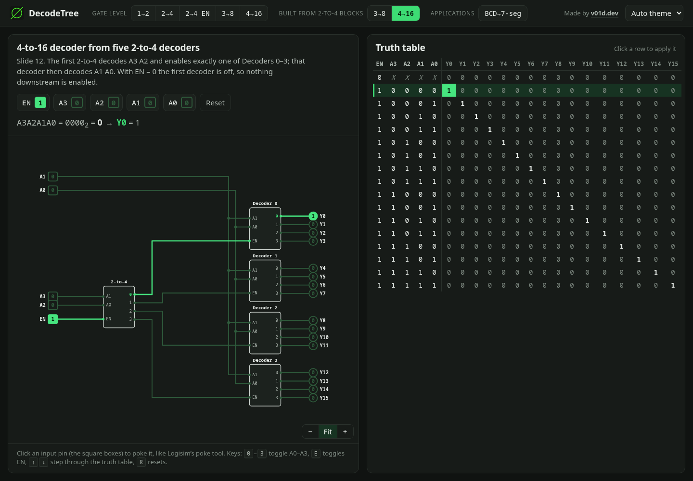
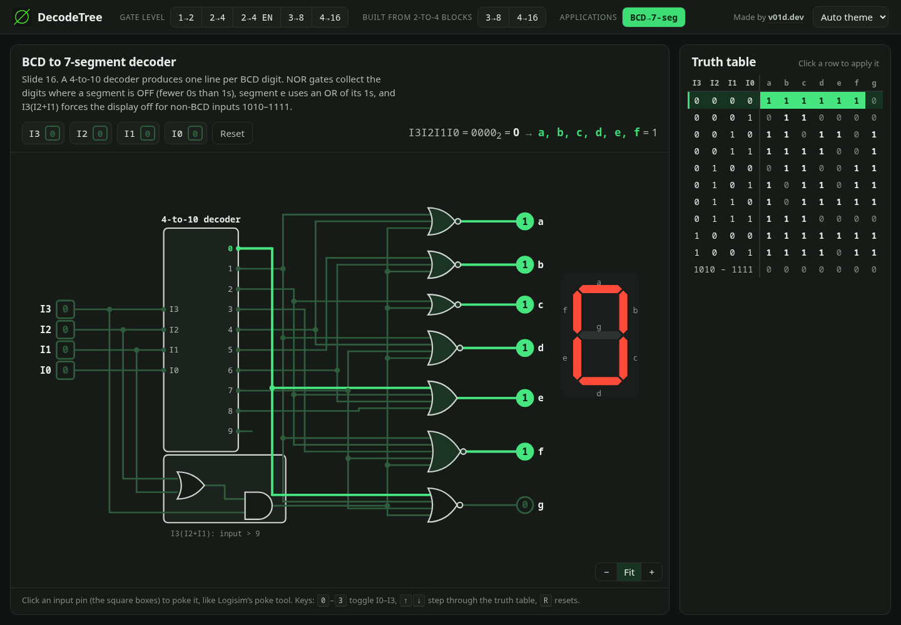
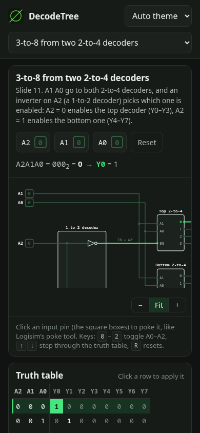

+++
date = '2026-11-26T19:54:28+03:00'
draft = false
title = 'Vibe Coding as a Backend Developer'
+++

## Introduction

I'm a backend developer who loves low level systems. I've never enjoyed any frontend framework. As a matter of fact, I have strong feelings about how web development is done nowadays. As a simple person who finds even the lowest level systems "creative", it hurts to see something as valuable and creative as frontend development turn into the same few patterns because of how "easy" AI has made it.

So it's a bit ironic that today I built [DecodeTree](https://decodetree.v01d.dev), an interactive decoder simulator, while sitting in a lecture. Every line of it was vibe coded. I didn't write the React, I didn't write the CSS, and honestly I couldn't have written most of it at that speed even if I wanted to.

This post is about when I think vibe coding actually makes sense, and why for me the answer is "when it helps the people around me".

## The Problem

The lecture was on decoders: 2-to-4, 3-to-8, building a 4-to-16 out of smaller 2-to-4 blocks, and a BCD to 7-segment decoder at the end. The slides had static diagrams and truth tables, and when my classmates were still confused about what was even going on, the same diagrams just got drawn again on the blackboard. The only way to see a circuit actually *do* something was to open Logisim (a tool not covered in this course) and build it yourself.

What I wanted was something where you could click an input, *watch the signal travel through the gates*, and see which row of the truth table lights up.

## Building It During the Lecture

So I opened my laptop and started describing what I wanted:

- A schematic for each circuit from the slides, drawn the way Logisim draws them.
- Clickable input pins, like Logisim's poke tool.
- A live truth table next to it, where clicking a row sets the inputs.
- Each circuit following the lecture slides, so you could follow along.

By the time the lecture part ended, it was done, just not deployed yet. That happened during the lab. The git history tells the rest: first commit at 15:53, deployed on Vercel at 16:01, and within the next hour it had CI checking every circuit, analytics, a proper logo, and mobile support. Before the lab was over, anyone in the class could open a link on their phone and play with the circuits we had just covered.

My job during all of this wasn't writing code. It was:

- **Knowing what correct looks like.** I was following the lecture, so I could tell when a circuit was wired wrong or a truth table row didn't match the slide.
- **Steering.** "Make the inputs keyboard driven." "The wires overlap here." "Make it work on a phone."
- **Shipping.** Pushing, deploying, putting it on a subdomain, and sharing the link.

That last point matters. As a backend developer I know how to get something from my laptop onto the internet. That part I didn't need AI for.

## Why This Would Have Been Impossible Without AI

Could I have built this by hand? Eventually, yes. But "eventually" means a weekend, not a lecture. I would have spent most of that time fighting SVG coordinates, layouts, and responsive CSS. Things that are trivial for a frontend developer and a slog for me.

By the time I finished, the lecture would be over and everyone would have moved on. A study tool that shows up a week late is mostly useless. The whole value of DecodeTree was that it existed *while people were learning the topic*.

## When I Think Vibe Coding Makes Sense

I'm not going to vibe code a backend service that handles people's data. For anything I need to maintain, debug at 3 AM, or trust with something important, I want to understand every line.

DecodeTree ticks every box for a project where vibe coding is the right call:

- **It's outside my expertise, but I can still judge the result.** I can't write the frontend, but I can absolutely tell if a decoder is wrong.
- **Speed matters more than perfection.** It's only useful if it exists now.
- **Low stakes.** It's a static site. No accounts, no data, nothing to leak. If something breaks, the worst case is a wrong wire on a diagram.
- **It helps other people.** This wasn't for me, I already understood decoders. It was for the classmates who didn't, and for anyone studying the topic later.

That's where I draw the line. Vibe coding isn't a replacement for knowing what you're doing. It's a way to cover the parts you *don't* know, as long as you know enough to check the output.

## Conclusion

I walked into a lecture about decoders, and before the lab was over the whole class had an interactive simulator they could use. As a backend developer, that's not something I could have done alone at that speed.

If you're studying decoders, give [DecodeTree](https://decodetree.v01d.dev) a try. And if you're a backend developer avoiding a frontend idea because "I'm not a frontend person", this might be the push you need. Just make sure you can tell when it's wrong.
